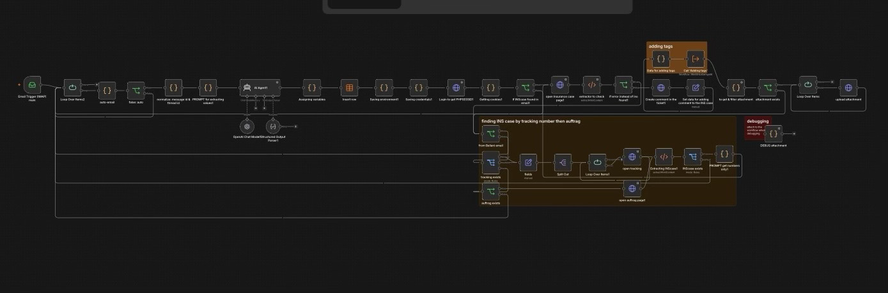

# ai-claimflow
n8n-openai-email-triage

# Automated Insurance Claims Email Triage (n8n + AI)

An n8n and AI-powered automation workflow that reads incoming claims emails, extracts structured case identifiers using an LLM, locates the matching insurance case (`INScase`) in the internal portal, and automatically posts comments, tags, and attachments to the ticket.

## Question

How can we eliminate manual email triage and reduce claim-update latency by automatically matching incoming emails to their corresponding insurance cases (`INScase`), logging the message as a ticket comment, applying relevant tags, and uploading attachments—even when the case ID is not explicitly stated in the email?

## Grain

One row / one execution unit per incoming email message (normalized by `message_id` and `thread_id`), with sub-loops per extracted identifier (tracking number / `Auftrag`) and per valid email attachment.

## Data Path

1. **Ingestion & Filtering**
   - `Email Trigger (IMAP)` listens for incoming emails and passes items into `Loop Over Items2`.
   - Automated/system replies are filtered out (`auto-email` → `false: auto`).
   - Message metadata is standardized (`normalize: message id & thread id`).

2. **AI Extraction & Logging**
   - `PROMPT for extracting values1` prepares the email payload for `AI Agent1` (backed by `OpenAI Chat Model1` and `Structured Output Parser1`) to extract structured identifiers (`INScase`, tracking numbers, `Auftrag` numbers, and relevant metadata).
   - `Assigning variables` maps the parsed output and logs a record via `Insert row`.

3. **Portal Authentication**
   - Environment and credential variables are loaded (`Saving environment1` → `Saving credentials1`).
   - An HTTP request authenticates to the internal claims portal (`Login to get PHPSESSID1` → `Getting cookies1`).

4. **Case Resolution (`INScase` Lookup)**
   - **Direct match (`If INScase found in email` = True):** Opens the case page (`open insurance case page1`) and validates the HTML response (`extractor to check` → `If error instead of ins found1`).
   - **Fallback lookup (`finding INS case by tracking number then auftrag`):** If no `INScase` is found directly, the workflow checks `from Beliani email` and branches into:
     - **Tracking path:** `tracking exists` → `fields` → `Split Out` → `Loop Over Items1` → `open tracking` → `Extracting INScase1` → `INScase exists` → `PROMPT get numbers only1`.
     - **Order path:** `auftrag exists` → `open auftrag page1`.

5. **Ticket Update, Tagging & Attachments**
   - **Tagging (`adding tags`):** Prepares tag payloads (`Data for adding tags`) and invokes a reusable sub-workflow (`Call 'Adding tags'`).
   - **Commenting:** Formats the payload (`Set data for adding comment to the INS case`) and posts the update (`Create comment in the ticket1`).
   - **Attachments:** Filters eligible files (`to get & filter attachment` → `attachment exists`), iterates through them (`Loop Over Items`), and uploads each file to the ticket (`upload attachment`).

## Refresh

**Event-driven:** Triggers automatically every time a new email arrives via IMAP (`Email Trigger (IMAP)`).

## Accuracy Check

- **Auto-reply guard:** Filters out automated emails (`false: auto`) before AI extraction to prevent noise and duplicate ticket comments.
- **Structured AI output:** Uses `Structured Output Parser1` to enforce a consistent schema from `OpenAI Chat Model1` before downstream variables are assigned.
- **Audit trail:** Logs every processed email and extracted variable set (`Insert row`) for traceability and post-run auditing.
- **Portal validation:** Verifies that the resolved `INScase` page loads without errors (`extractor to check` → `If error instead of ins found1`) before posting comments or tags.
- **Fallback verification:** When resolving via tracking number or `Auftrag`, explicitly checks `INScase exists` and strips non-numeric noise (`PROMPT get numbers only1`).
- **Debugging support:** Includes an isolated `debugging` branch (`DEBUG attachment`) that can be attached to the workflow during troubleshooting without affecting production runs.

## Governance

- **Owner:** Hanifah PD
- **Reviewer:** Resell and Claims Team Leader
